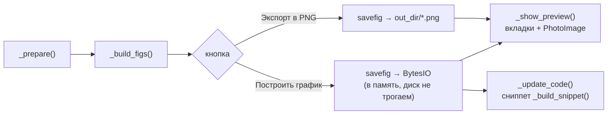

# GraphLab — архитектура приложения

Портативное GUI-приложение + CLI-скрипт для построения графиков по данным
GraphLab (`.dat`-файлы). Результат — PNG-картинки; GUI показывает окно
Python-кода (самодостаточный сниппет matplotlib), CLI печатает строки
Markdown (``) для вставки в отчёты.

Версия: v1.0.5. Язык интерфейса: русский. Целевая ОС: Windows.

---

## 1. Состав репозитория

| Путь | Назначение |
| --- | --- |
| `graphlab_app.py` (1353 строки) | Основное Tkinter-приложение, один файл: GUI + логика построения + проекты `.gslab` |
| `graph.py` (106 строк) | CLI с той же логикой чтения `.dat`, без GUI |
| `GraphLab_onedir.spec` | Спецификация PyInstaller onedir-сборки |
| `README.md` | Пользовательская документация (v1.0.5) |
| `REVIEW_TZ.md` | Ревью репозитория и ТЗ доработок v1.0.3 (R1–R4) |
| `REVIEW_TZ_v1.0.4.md` | Ревью и ТЗ доработок v1.0.4 (R6–R8: скролл левой колонки, колесико мыши, окно Python-кода) |
| `REVIEW_TZ_v1.0.5.md` | Ревью и ТЗ доработок v1.0.5 (R9–R18: карточка «Данные» на всю левую панель, окно при старте 1450×815, предпросмотр всегда вписанный, авто-скролл бокса «Данные», зазор 24 px между панелями, правило запуска окна, постоянная нижняя строка с кнопкой и скроллбар на 12 px внутрь) |
| `in/*.dat` | Примеры данных: `x.dat`, `result_tav.dat`, `result_tw1.dat`, `result_tw2.dat` |
| `env/` | venv Python 3.15.1 с matplotlib, numpy, Pillow, PyInstaller (не коммитится; внутри `Lib/site-packages/sitecustomize.py` — обход DACL-ограничения песочницы DSH при `os.mkdir(mode=)`) |
| `dist/GraphLab/` | Портативная onedir-сборка: `GraphLab.exe` + `_internal\` |
| `.gitignore` | Исключает `env/`, `build/`, `dist/`, `__pycache__/`, `*.exe` |

Два независимых входа в один и тот же функционал:

- **GUI** — `graphlab_app.py` (или собранный `GraphLab.exe`);
- **CLI** — `graph.py`, аргументы `[x_file] [y_file ...]`.

Логика разбора чисел намеренно продублирована в обоих файлах (решение зафиксировано
в `REVIEW_TZ.md`, «Не в скопе»: вынести в общий модуль можно позже).

---

## 2. Архитектура GUI (`graphlab_app.py`)

Один файл, три слоя:

1. **Модульный уровень** — тема, утилиты разбора данных, пути.
2. **`YLine`** — одна линия графика (состояние + свой фрагмент UI).
3. **`App`** — окно, состояние проекта, конвейер построения, проекты `.gslab`.

Зависимости: `tkinter` (встроен), `matplotlib` (бэкенд `Agg`, без окна),
`Pillow` (`Image`/`ImageTk` для предпросмотра). Никаких других.

### 2.1 Модульный уровень

| Сущность | Строки | Роль |
| --- | --- | --- |
| `T` (dict) | `graphlab_app.py:34-37` | Палитра интерфейса: плоский светлый дизайн (bg, card, accent, ok, err, border…) |
| `F_BODY / F_SMALL / F_HEAD` | `graphlab_app.py:39-41` | Шрифты Segoe UI 8/9/10 |
| `PALETTE` | `graphlab_app.py:44-45` | 8 цветов линий по умолчанию (данные, не интерфейс) |
| `app_dir()` | `graphlab_app.py:48-52` | Папка приложения: для exe — папка с exe (`sys.frozen`), для скрипта — папка скрипта |
| `user_dir()` | `graphlab_app.py:55-60` | `%APPDATA%\GraphLab` (создаётся при необходимости) — config.json и last.gslab |
| `parse_numbers(text)` | `graphlab_app.py:63-78` | Разбор чисел из строки: разделители `;`, пробелы, табы, запятые; экспоненциальная запись `3.9211E+02`; нечисловые токены игнорируются |
| `read_numbers(path, start_line)` | `graphlab_app.py:81-90` | Обёртка: читает файл (`utf-8-sig`, CRLF), отбрасывает строки < `start_line`, передаёт в `parse_numbers` |
| `safe_name(name)` | `graphlab_app.py:93-95` | Санитизация имени файла (запрещённые символы → `_`) |
| `_style_ax(ax)` | `graphlab_app.py:98-103` | Единый вид оси: без верхних/правых рамок, лёгкая сетка, легенда |

Поля X/Y принимают **либо путь к `.dat`, либо сырые числа** — код ветвится по
`os.path.isfile(...)` (см. `_prepare`, `graphlab_app.py:720-736`).

### 2.2 Класс `YLine` (`graphlab_app.py:106-201`)

Одна линия графика. Состояние — Tk-переменные + цвет:

| Поле | Значение по умолчанию |
| --- | --- |
| `path_var` | путь Y (файл или числа) |
| `legend_var` | `линия N` (N = индекс палитры, не сбрасывается при удалении) |
| `start_var` | `4` — строка начала чтения Y |
| `x_path_var` | свой X (необязательно; если пуст — берётся общий X) |
| `x_start_var` | `1` — строка начала чтения своего X |
| `color` | `PALETTE[index % 8]` |

UI — карточка-строка: ряд 0 (файл Y + «...» + кнопка цвета «■» + «✕»), ряд 1
(легенда + «Y с:»), ряды 2–3 (свой X + «X с:»). Действия:

- `_pick_file` (`graphlab_app.py:169-179`) — выбор `.dat`; если легенда ещё
  дефолтная (`линия N`), подставляется stem файла;
- `_pick_x_line` (`graphlab_app.py:181-186`) — свой X;
- `_pick_color` (`graphlab_app.py:188-193`) — colorchooser, помечает проект dirty;
- `_remove` (`graphlab_app.py:196-201`) — удаляет строку из `app.lines`.

Все пять переменных подписаны на `trace_add("write") → app._mark_dirty()`
(`graphlab_app.py:120-122`).

### 2.3 Класс `App` (`graphlab_app.py:204-1337`)

#### Состояние

| Поле | Назначение |
| --- | --- |
| `project_path` | путь открытого `.gslab`; `None` = «Новый проект» |
| `_dirty` | есть несохранённые изменения (звёздочка в заголовке) |
| `_loading` | suppress dirty-меток при программной загрузке проекта |
| `x_file, title_var, xlabel_var, ylabel_var, out_dir, combined_name` | StringVar общего уровня; `out_dir` по умолчанию = `app_dir()` |
| `combined` | BooleanVar: «все на одном графике» |
| `lines` / `_line_counter` | список `YLine`; счётчик индекса палитры (не сбрасывается) |
| `code_text`, `status`, `nb` | окно Python-кода, статус-строка, Notebook предпросмотра |

#### Фабрики виджетов

`_reg` (`graphlab_app.py:248-256`) — регистрация виджета: роль `field` даёт
контекстное меню по ПКМ (Cut/Copy/Paste/SelectAll). На его основе `_entry`,
`_btn`, `_muted_label` (`graphlab_app.py:257-276`) и макеты карточек
`_card` / `_field_row` (`graphlab_app.py:403-434`).

#### Меню и горячие клавиши

Меню «Файл» (Новый/Открыть/Сохранить/Сохранить как…/Выйти) и «Правка»
(`graphlab_app.py:277-314`). Ключевая особенность — **раскладка-независимые**
Ctrl-ускорители, три уровня диспетчеризации в `_ctrl_key`
(`graphlab_app.py:360-397`):

1. `keysym` по таблицам `_HOTKEYS` / `_HOTKEYS_SHIFT`
   (`graphlab_app.py:322-331`) — англ. + ЙЦУКЕН (`n/т`, `s/ы`, …);
2. Unicode-символы Tk вида `U0442` — декодируются в символ и ищутся в той же таблице;
3. Fallback на **физические коды клавиш (VK)** через
   `ctypes.windll.user32.GetAsyncKeyState` — таблица `_VK_HOTKEYS`
   (`graphlab_app.py:337-345`), `_vk_action` (`graphlab_app.py:347-359`).
   Нужен, когда Tk не перевёл символ в keysym (keysym `??`, например русская
   раскладка внутри замороженного exe).

Редакторские действия (`<<Cut>>/<<Copy>>/<<Paste>>/<<SelectAll>>`) генерируются
виртуальным событием на виджете с фокусом — `_focus_event`
(`graphlab_app.py:315-318`); работает для всех Entry/Text, т.к. Tk на Windows
нативно эти клавиши не мапит.

#### Раскладка окна (`_build_ui`, `graphlab_app.py:435-587`)

```
┌──────────────────────────────┬──────────────────────────────────┐
│  ЛЕВАЯ ПАНЕЛЬ (настройки)    │  ПРАВАЯ ПАНЕЛЬ (результат)       │
│ ┌ Данные (скроллится) ────┐ │ ┌ Построить график │ Экспорт в PNG │ статус ┐
│ │ Файл X [........] [Выбр.]│ │ ├───────────────────────────────────────┤
│ │ Линии Y:                │ │ │  Notebook: вкладка на каждый PNG      │
│ │  [Y-файл][...][■][✕]    │ │ │  (canvas, вписано без ползунков)      │
│ │  [легенда]   Y с: [4]   │ │ ├───────────────────────────────────────┤
│ │  Свой X (необязательно) │ │                                       │
│ │  [X-файл][...] X с: [1] │ │ ├───────────────────────────────────────┤
│ └──────────────────────────┘ │ │ Python-код (сниппет matplotlib)     │
│ [+ Добавить линию] ← строка │ │              [Скопировать код]   │
│  бокса, не прокручивается   │ │              [Открыть папку]        │
│ ┌ График ─────────────────┐ │ │              [Открыть папку]        │
│ │ Название / ось X / ось Y│ │ └───────────────────────────────────────┘
│ │ ☐ Все линии на одном    │ │
│ │ Имя объединённого: [...]│ │
│ └──────────────────────────┘ │
│ ┌ Вывод ───────────────────┐ │
│ │ Папка для PNG [....][Выб.]│ │
│ └──────────────────────────┘ │
└──────────────────────────────┴──────────────────────────────────┘
```

Две кнопки вверху справа — центральный разрыв интерфейса (ТЗ R3):
**«Построить график»** (`preview_graph`) и **«Экспорт в PNG»** (`export_png`).

Карточка «Данные» растянута на всю ширину и высоту левой панели (ТЗ R9, R11) и
прокручивается вертикальным скроллбаром **внутри бокса** при переполнении
(ТЗ R6 + исправление 1, R12: авто-скрытие, когда содержимое помещается —
`_update_left_scroll`, `graphlab_app.py:591-644`). Состояние скролла
атомарно: один вычисленный режим («помещается/переполнение») за один проход
выставляет все три величины — видимость бегунка, высоту item, scrollregion
(R14.1); после выставления проверяется согласованность (в режиме «помещается»
scrollregion пуст и `yview() == (0.0, 1.0)`), при несовпадении — один повтор
через `after(0)`. Пересчёт — из `<Configure>` canvas/inner и отложенно
(`after(0)`) после `add_line`/`_remove`; перед измерением `update_idletasks()`
доводит геометрию до готовности, чтобы `winfo_reqheight()` читал просчитанные
высоты строк (R14.2); переход «переполнение» → «помещается» сбрасывает
позицию прокрутки, в режиме «помещается» scroll-диапазона нет вовсе (R14.3).
`data_box` двухстрочный: row 0 — canvas + вертикальный scrollbar, row 1 — постоянная
нижняя строка с кнопкой «+ Добавить линию»; кнопка не внутри прокручиваемой карточки,
нижняя граница бокса не двигается при добавлении/удалении линий и при смене режима
скролла (R18.1).
Карточки «График» и «Вывод» статичны. Колесико мыши: вниз — вниз, вверх — вверх
— над панелью данных и Python-кодом (ТЗ R7 + исправление 2, `_on_mousewheel`,
`graphlab_app.py:958-995`); над боксом «Данные» прокрутка только при реальном
переполнении — страж по высоте `bbox("all")` (R14.4); над вкладками
предпросмотра реакции нет — изображения всегда вписаны (ТЗ R10.5).

Левая панель отделена от правой зазором 24 px (R15.1): `left` — `padx=(12, 18)`,
`right` — `padx=(6, 12)`. Зона под scrollbar зарезервирована на `VBAR_W + 12`
(`data_box.columnconfigure(1, minsize=VBAR_W + 12)`), сам scrollbar размещён с
`padx=(0, 12)` — на 12 px внутрь от правой границы бокса (R18.2); карточки «График»
и «Вывод» имеют `padx=(0, VBAR_W + 12)`, поэтому правые края всех трёх левых боксов
совпадают в обоих режимах скролла (R15.2–R15.3, R18.3).

### 2.4 Конвейер построения

Общий путь для обеих кнопок:



- **`_prepare()`** (`graphlab_app.py:694-753`) — валидация и сборка.
  Для каждой линии: целочисленность «Y с:»/«X с:», X = свой или общий,
  чтение файла или `parse_numbers` для сырых чисел, обрезка до
  `n = min(len(xs), len(ys))`. Ошибки чтения — диалог `showerror`;
  пропуски (нет X/Y, нет данных, разная длина) — список `warnings`.
  Возврат: `(prepared, warnings)` или `None` (ошибка показана).
- **`_build_figs(prepared)`** (`graphlab_app.py:755-785`) — фигуры matplotlib
  (`figsize=(9,5)`, `dpi=150`): объединённый график с общей легендой
  (имя = `combined_name`) или по одному на линию (имя = легенда,
  заголовок `{title} — {label}`). Возврат: список `(fig, name, caption)`.
- **`preview_graph()`** (`graphlab_app.py:858-882`) — рендер каждого fig в
  `io.BytesIO` → `Image.open(buf)`; **на диск ничего не пишется**;
  статус «Предпросмотр: N график(ов), файлы не записаны» (⚠ при warnings);
  окно Python-кода обновляется: `self._update_code(self._build_snippet(prepared))`.
- **`export_png()`** (`graphlab_app.py:884-909`) — разрешение `out_dir`:
  явная папка → каталог основного X → `app_dir()`; `os.makedirs`;
  `fig.savefig(path)` на диск; статус «Экспорт: N PNG в …». Окно
  Python-кода при экспорте не меняется (обновляется только по «Построить
  график»).
- **`_py_str(s)` / `_build_snippet(prepared)` / `_update_code(text)`**
  (`graphlab_app.py:788-856`) — генерация самодостаточного Python-сниппета
  (matplotlib, `repr(float)` для координат, сохранение в `plots/`,
  `plt.show()`); окно кода — `tk.Text` с state DISABLED, обновление через
  NORMAL/insert/DISABLED.

### 2.5 Предпросмотр (вкладки)

`_show_preview(images)` (`graphlab_app.py:920-937`) — вкладка `ttk.Notebook`
на каждое изображение; canvas на всю вкладку, без скроллбаров (ТЗ R10.4).
Каждая вкладка хранит `{frame, canvas, orig (PIL), photo}`.
`_update_preview_for(entry)` (`graphlab_app.py:939-955`) — изображение всегда
вписано в доступное пространство: масштаб `min((w-20)/W, (h-20)/H, 1.0)`
(cap 1.0 — без апскейла), центрировано; `scrollregion` не задаётся (ТЗ R10.3).
Перерисовка по `<Configure>`. Колесико мыши над вкладкой графика реакции не
даёт (`_on_mousewheel`, ТЗ R10.5).

### 2.6 Проекты `.gslab` и dirty-состояние

**Формат** — JSON v1 (`save_project`, `graphlab_app.py:1095-1133`):

```json
{
  "version": 1,
  "x_file": "x.dat",
  "lines": [
    {"path": "result_tav.dat", "legend": "TAV", "start": 4,
     "color": "#4682b4", "x_path": "", "x_start": 1}
  ],
  "title": "График", "xlabel": "X", "ylabel": "Y",
  "combined": false, "combined_name": "combined",
  "out_dir": ".",
  "geometry": "1160x760+..."
}
```

Пути **внутри папки проекта пишутся относительными** (функция `rel`,
`graphlab_app.py:1100-1110`), остальные — абсолютными → проект переносим
вместе с данными. Загрузка: `load_project` (`graphlab_app.py:1135-1146`) →
`load_project_from_dict` (`graphlab_app.py:1148-1157`, suppress dirty через
`_loading`) → `_load_project_data` (`graphlab_app.py:1159-1205`).
`_project_resolves` (`graphlab_app.py:1207-1228`) — проверка, что файлы
проекта существуют (или поля содержат сырые числа). Старые `.gslab` с ключом
`fit_preview` читаются терпимо — ключ игнорируется, `version` остаётся 1.
Ключ `geometry` при запуске применяется через правило запуска
(`_apply_launch_geometry`, R16.1); при открытии проекта в середине сессии
(Ctrl+O) — как есть, без перепозиционирования (R16.2).

**Dirty-трекинг**: любое пользовательское изменение (trace на переменных,
добавление/удаление линий, выбор цвета) → `_mark_dirty`
(`graphlab_app.py:1014-1019`) → звёздочка в заголовке. Заголовок —
`_update_title` (`graphlab_app.py:1026-1034`): `Новый проект` / `<имя>*` +
« — GraphLab». Подтверждение потери изменений — `_confirm_discard`
(`graphlab_app.py:1036-1048`, askyesnocancel: Да = сохранить, Нет = продолжить,
Отмена = ничего). Точки входа: «Новый проект» (`_menu_new_project`,
`graphlab_app.py:1063-1092`), «Открыть…» (`_menu_open_project`,
`graphlab_app.py:1326-1337`), закрытие окна (`_on_close`, `graphlab_app.py:1297-1301`).

### 2.7 Автосохранение и восстановление сессии

- `_autosave()` (`graphlab_app.py:1231-1239`) — при закрытии окна пишет
  `%APPDATA%\GraphLab\config.json` (геометрия) и `last.gslab` (полный проект).
  Ошибки молча игнорируются.
- `_restore_state()` (`graphlab_app.py:1258-1295`) — при запуске: геометрия из
  config.json, по правилу запуска; `last.gslab` загружается **молча, только если
  пути резолвятся** (`_project_resolves`). После восстановления `project_path = None`,
  `_dirty = False` → состояние трактуется как «Новый проект» с данными
  (решение R1.10 из ТЗ): Ctrl+S откроет «Сохранить как…».
- `_apply_launch_geometry(geom)` (`graphlab_app.py:1241-1256`) — правило запуска
  (R16.1): окно не уже 1450 px, правый край у правого края экрана,
  вертикальное центрирование; размер клампится по экрану, неразбираемая
  геометрия → дефолт 1450×815.

### 2.8 Запуск

`main()` (`graphlab_app.py:1340-1349`): HiDPI-awareness через
`ctypes.windll.shcore.SetProcessDpiAwareness(1)`, `tk.Tk()`, `App(root)`,
`root.mainloop()`. Окно по умолчанию 1450×815, minsize 1024×576; сохранённая
геометрия при запуске — по правилу запуска (§2.7): не уже 1450 px, правый край
у экрана, вертикальное центрирование (R16).

---

## 3. CLI-скрипт (`graph.py`)

Та же логика без GUI:

| Функция | Строки | Роль |
| --- | --- | --- |
| `read_numbers(path, start_line)` | `graph.py:38-58` | Чтение чисел из `.dat` (utf-8-sig, E-запись, CRLF) |
| `make_graph(x, y, png_file, title)` | `graph.py:61-74` | Один график → PNG (`figsize=(10,6)`, dpi 150, Agg) |
| `main()` | `graph.py:77-102` | Аргументы `[x] [y...]`; по умолчанию `x.dat` + три `result_*.dat`; `Y_START_LINE = 4`; заголовок из stem (`result_tav` → `TAV`); на stdout — `` |

Бэкенд matplotlib принудительно `Agg` (`graph.py:22`) — работает и в CI.

---

## 4. Формат данных `.dat`

- **X** (`x.dat`): значения через `;` (или пробелы).
- **Y** (`result_*.dat`): первые 3 строки — заголовок и начальные значения
  (пропускаются), данные с 4-й строки. Числа в экспоненциальной записи
  (`3.9211E+02`), разделители — пробелы/табы, CRLF, BOM допускается
  (`utf-8-sig`).

---

## 5. Сборка и распространение

PyInstaller **onedir** по `GraphLab_onedir.spec`:

```
env\Scripts\pyinstaller.exe GraphLab_onedir.spec --noconfirm
→ dist\GraphLab\GraphLab.exe + dist\GraphLab\_internal\
```

Ключевые параметры spec: `exclude_binaries=True` (exe отделён от `_internal`),
`console=False` (GUI без консоли), `runtime_tmpdir=None` — **временные папки
при запуске не создаются**. Распространяется и запускается целиком папка
`dist\GraphLab\`, установка не нужна.

---

## 6. Ключевые проектные решения

1. **Один файл GUI**, минимальный стек (tkinter + matplotlib Agg + Pillow) —
   упрощает onedir-сборку и переносимость.
2. **Предпросмотр и экспорт раздельно** (R3): рендер в `BytesIO` без записи на
   диск; PNG создаются только по кнопке «Экспорт в PNG». Окно Python-кода
   обновляется только при предпросмотре (не при экспорте).
3. **Портативные проекты `.gslab`**: JSON v1 с относительными путями внутри
   папки проекта — проект переносится вместе с данными; человекочитаемый.
4. **Раскладка-независимые хоткеи**: keysym-таблицы (англ.+ЙЦУКЕН) + Unicode
   fallback + физические VK-коды через WinAPI — работают в любой раскладке,
   включая замороженный exe.
5. **Виртуальные события Tk** (`event_generate`) для Ctrl+C/V/X/A на виджете с
   фокусом — единый механизм для всех Entry/Text (Tk на Windows эти клавиши
   нативно не мапит).
6. **Сырые числа вместо файлов** допустимы в любом поле X/Y — удобно для
   коротких рядов без создания `.dat`.
7. **Автосохранение сессии** (`last.gslab`) молча и только при резолвящихся
   путях; восстановленное состояние = «Новый проект» (не привязано к файлу).
8. **Дублирование парсера** в `graph.py` и `graphlab_app.py` осознанно
   (см. `REVIEW_TZ.md`, «Не в скопе») — каждый вход самодостаточен.
