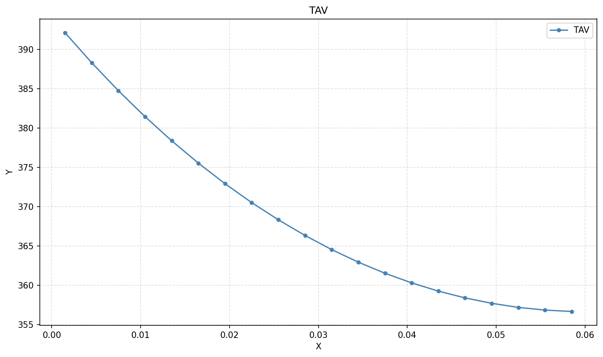

# graphslab9

Инструменты для построения графиков по данным GraphLab (`.dat`-файлы):
портативное GUI-приложение и CLI-скрипт. На выходе — готовые PNG и строки
для вставки в Markdown.

## Портативное приложение (v1)

`GraphLab.exe` — однофайловое Windows-приложение, установка не нужна:
просто запустить двойным кликом.

Возможности:

- выбор `.dat` файла оси X и линий Y из проводника (несколько файлов сразу);
- цвет каждой линии: палитра по умолчанию + произвольный выбор цвета;
- подписи легенды — редактируемые, подставляются автоматически из имени файла;
- режим «Все линии на одном графике» — объединённый PNG с общей легендой;
- названия осей и графика, строка начала чтения Y (по умолчанию 4);
- предпросмотр графика в окне и копирование Markdown-строк в буфер обмена.

Результат: для каждого Y-файла создаётся PNG (имя — как у файла), а при
объединённом режиме — один файл с заданным именем, плюс строки вида:

```

```

Сборка из исходника (`graphlab_app.py`):

```
pip install matplotlib pillow pyinstaller
pyinstaller --onefile --windowed --name GraphLab graphlab_app.py
```

## CLI-скрипт

`graph.py` — та же логика без GUI. Требуется Python с matplotlib
(в папке `env/` уже есть venv):

```
env\Scripts\python.exe graph.py
```

Можно передать свои файлы:

```
env\Scripts\python.exe graph.py x.dat result_tav.dat result_tw1.dat
```

Для каждого Y-файла создаётся PNG (имя — как у файла) и на stdout печатается
строка для Markdown. Настройки (имена файлов, строка начала чтения Y) —
в начале `graph.py`.

## Формат данных

- `x.dat` — значения оси X, через `;` (или пробелы).
- `result_*.dat` — значения оси Y: первые 3 строки — заголовок и начальные
  значения (пропускаются), данные читаются с 4-й строки. Числа в экспоненциальной
  записи (`3.9211E+02`), разделители — пробелы/табы/точки с запятой, CRLF.
