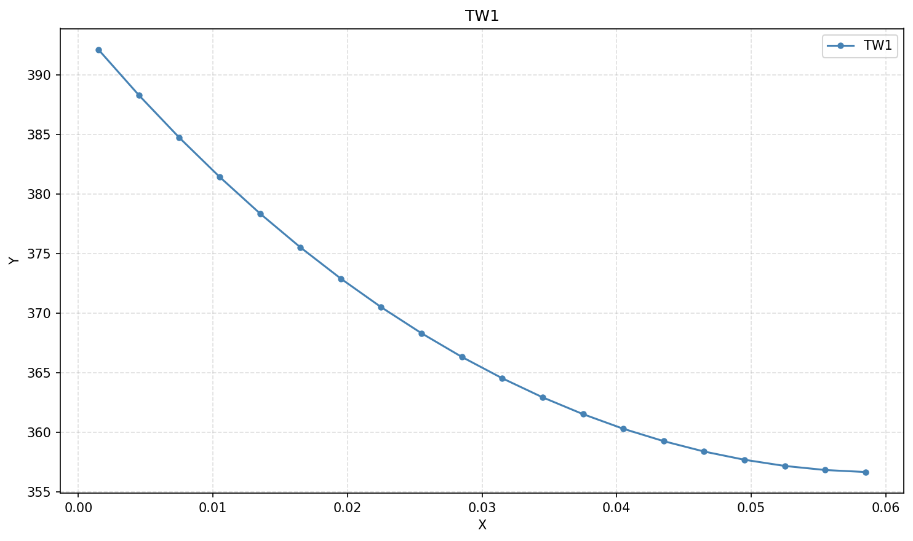
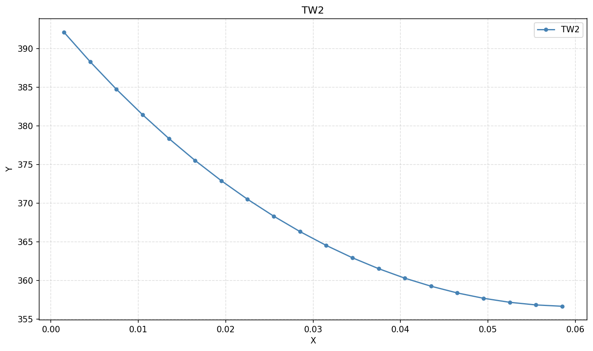

# graphslab9

Скрипт для построения графиков по данным GraphLab (`.dat`-файлы) с готовой
строкой для вставки в Markdown.

## Формат данных

- `x.dat` — значения оси X, через `;` (или пробелы).
- `result_*.dat` — значения оси Y: первые 3 строки — заголовок и начальные
  значения (пропускаются), данные читаются с 4-й строки. Числа в экспоненциальной
  записи (`3.9211E+02`), разделители — пробелы.

## Запуск

Требуется Python с matplotlib (в папке `env/` уже есть venv):

```
env\Scripts\python.exe graph.py
```

Можно передать свои файлы:

```
env\Scripts\python.exe graph.py x.dat result_tav.dat result_tw1.dat
```

## Результат

Для каждого Y-файла создаётся PNG (имя — как у файла) и на stdout печатается
строка для Markdown:

```



```

Настройки (имена файлов, строка начала чтения Y) — в начале `graph.py`.
